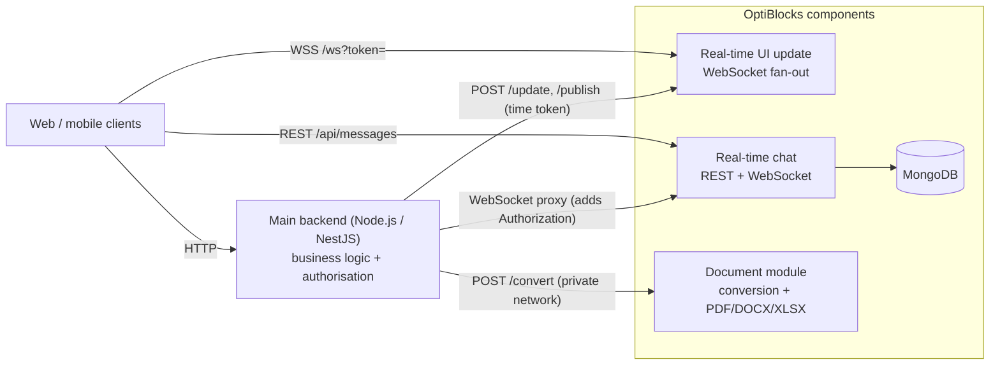

# OptiBlocks: Plug-and-Play Backend Components

[](https://hub.docker.com/u/slincsilver)
[](https://go.dev)
[](LICENSE)

A collection of small, production-oriented Go microservices that drop into an existing backend as components. Each one moves a CPU-bound or connection-heavy job out of the main backend. Examples are WebSocket fan-out, chat delivery, and format conversion or document rendering. The main backend (Node.js/NestJS or any other stack) stays focused on business logic.

Every component is published on Docker Hub as a signed, multi-arch image. It is configured with a handful of environment variables and integrated over plain HTTP and WebSockets.

## Components

| Component | Image | What it does |
|-----------|-------|--------------|
| [Real-time UI update](https://github.com/SantiagoLopezDeharo/real-time-ui-update-microservice) | [](https://hub.docker.com/r/slincsilver/real-time-ui-update-microservice) [`slincsilver/real-time-ui-update-microservice`](https://hub.docker.com/r/slincsilver/real-time-ui-update-microservice) | Backend publishes one authenticated `POST`; the service fans it out over WebSockets to every subscriber of a channel, or to a single user's `user:<id>` channel |
| [Real-time chat](https://github.com/SantiagoLopezDeharo/real-time-chat-microservice) | [](https://hub.docker.com/r/slincsilver/real-time-chat-microservice) [`slincsilver/real-time-chat-microservice`](https://hub.docker.com/r/slincsilver/real-time-chat-microservice) | One-to-one and group chat identified by participants, with REST send and history, WebSocket delivery, batched MongoDB persistence and JWT auth |
| [Document module](https://github.com/SantiagoLopezDeharo/document-module-microservice) | [](https://hub.docker.com/r/slincsilver/document-module-microservice) [`slincsilver/document-module-microservice`](https://hub.docker.com/r/slincsilver/document-module-microservice) | Converts between JSON, YAML, TOML, XML, CSV/TSV, MsgPack, Properties and XLSX, and renders PDF, DOCX and XLSX documents from JSON instructions |

## Pull and run

```shell
docker pull slincsilver/real-time-ui-update-microservice:1.1.0
docker pull slincsilver/real-time-chat-microservice:1.0.1
docker pull slincsilver/document-module-microservice:1.0.1
```

### Run each one on its own

```shell
# Real-time UI update: backend publishes with a time token, browsers subscribe with a JWT
docker run -d -p 8080:8080 --read-only --cap-drop=ALL --security-opt=no-new-privileges \
  -e JWT_SECRET="$(openssl rand -hex 32)" -e TIME_TOKEN_SECRET="$(openssl rand -hex 32)" \
  slincsilver/real-time-ui-update-microservice:1.1.0

# Real-time chat: needs MongoDB
docker network create chat
docker run -d --name chat-mongodb --network chat mongo:7.0
docker run -d -p 8080:8080 --network chat --read-only --cap-drop=ALL --security-opt=no-new-privileges \
  -e JWT_SECRET="$(openssl rand -hex 32)" -e MONGO_URI=mongodb://chat-mongodb:27017 \
  slincsilver/real-time-chat-microservice:1.0.1

# Document module: no auth, so keep it on a private network; needs a writable /tmp
docker run -d -p 127.0.0.1:8080:8080 --read-only --tmpfs /tmp:size=512m,mode=1777 \
  --cap-drop=ALL --security-opt=no-new-privileges \
  slincsilver/document-module-microservice:1.0.1
```

### Run the whole collection

[`docker-compose.yml`](docker-compose.yml) starts all three, plus MongoDB for chat, with hardened container settings:

```shell
export UI_UPDATE_JWT_SECRET=$(openssl rand -hex 32)
export UI_UPDATE_TIME_TOKEN_SECRET=$(openssl rand -hex 32)
export CHAT_JWT_SECRET=$(openssl rand -hex 32)
docker compose up -d

curl http://localhost:8081/healthz   # ui-update
curl http://localhost:8082/health    # chat
curl http://localhost:8083/health    # document (bound to 127.0.0.1)
```

### First calls

```shell
# Convert CSV to JSON with the document module
printf 'name,qty\nwidget,3\n' | curl -s -X POST 'http://localhost:8083/convert?input=csv&output=json' --data-binary @-
```

For the time token the UI update service expects, the chat JWT claims, the full API of each service and typed TypeScript clients, see each repository's README or the [integration skill](#use-with-ai-coding-agents).

## Example architecture



- **Browsers** connect to the UI update service directly with a short-lived JWT in the query string. The chat WebSocket requires an `Authorization` header, which browsers cannot set on a WebSocket, so it goes through a backend proxy. Chat REST can be called directly.
- **The backend** publishes UI events after its database commits and calls the document module over the private network only.
- **TLS** is terminated by a reverse proxy or load balancer in front of anything browsers reach.

## Use with AI coding agents

[`skills/optiblocks-integration/`](skills/optiblocks-integration) is an [Agent Skill](https://docs.claude.com/en/docs/agents-and-tools/agent-skills/overview). It gives a coding agent everything it needs to integrate these components into a backend:
- which service fits which need;
- how to add the containers and secrets;
- how to bridge the product's authentication to each service's token format;
- the exact API contracts and error statuses;
- typed TypeScript clients and browser wiring;
- gotchas and a smoke test per service.

```
skills/optiblocks-integration/
├── SKILL.md                  # overview, service selection, integration workflow, security checklist
└── references/
    ├── ui-update.md          # real-time UI update: contract, time tokens, client, smoke test
    ├── chat.md               # real-time chat: contract, JWT claims, WebSocket proxy, smoke test
    └── document.md           # document module: formats, generation schema, client, smoke test
```

To install it, copy the folder into the agent's skills directory: for Claude Code, `~/.claude/skills/` for all projects or `.claude/skills/` in one project. Any other agent can be pointed at `SKILL.md`. It is plain Markdown that links to its references.

```shell
git clone https://github.com/SantiagoLopezDeharo/OptiBlocks-collection.git
cp -r OptiBlocks-collection/skills/optiblocks-integration ~/.claude/skills/
```

## What "plug and play" means here

- **Small interfaces**: a few HTTP routes and one WebSocket endpoint per service, each documented with every status code.
- **Configuration by environment variables**: invalid configuration stops the service at startup with every problem listed.
- **Operationally boring**: health endpoints, graceful shutdown on `SIGTERM`, bounded memory per connection and per request, and slow-consumer protection.
- **Tested like products**: unit tests with the race detector, fuzzing, and black-box end-to-end suites. Those suites boot the real binary or image and attack it with forged tokens, protocol abuse, floods and races. A performance suite profiles each service and reports optimisation opportunities.

## Image security and supply chain

All images follow the same release process:
- **Minimal base**: `FROM scratch`, a static binary and non-root UID `65532`, with no shell or package manager.
- **Pinned, reproducible builds**: the builder image is pinned by digest, module checksums are verified, and rebuilding a commit yields the identical digest.
- **Scan-gated publishing**: a release is refused if `govulncheck` finds a reachable vulnerability or Docker Scout finds a fixable critical or high CVE.
- **SBOM and SLSA provenance** (max mode) are attached to every release.
- **Keyless cosign signatures**: verify any image before deploying:

```shell
cosign verify slincsilver/real-time-ui-update-microservice:1.1.0 \
  --certificate-identity=santiagolhgpro@gmail.com \
  --certificate-oidc-issuer=https://accounts.google.com
```

Run them with a read-only root filesystem, all capabilities dropped and `no-new-privileges`, as the compose file does. Pin version tags or digests in production rather than `latest`.

## License

MIT, see [LICENSE](LICENSE). Each component repository carries its own MIT license.
